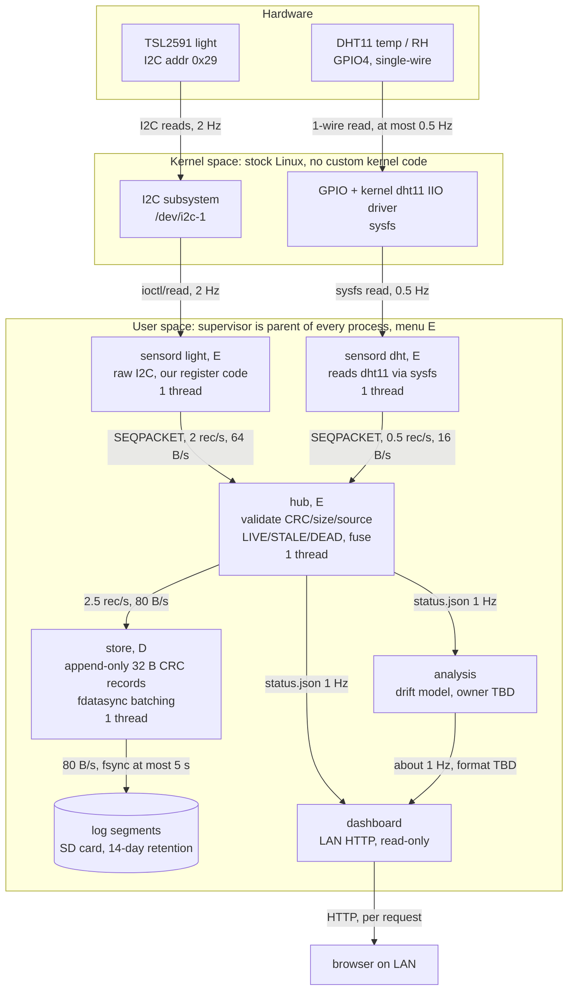

# 1. Architecture

Every process is a separate C binary under `src/`. Threads: each process is a single-threaded event loop and concurrency comes from separate processes **[proposed]**. Kernel components are stock (I2C subsystem, kernel `dht11` IIO driver); our code starts at the sensord boundary. The dashboard also reads history from the log on request. Rates are targets until measured **[Pi: unverified]**; the DHT11 cannot be read faster than about 1 Hz and about 10% of reads fail.

## IPC contract (sensord, hub, store)

- Transport: `AF_UNIX`, `SOCK_SEQPACKET`. Each message is exactly one 32-byte `struct cs370_record` (`src/common/record.h`). SEQPACKET keeps message boundaries, and a dead peer shows up as EOF on the next read, so the hub learns about a dead sensord without waiting for a timeout.
- Sockets: the hub listens on `$CS370_RUN_DIR/hub.sock` and every sensord connects to it. The store listens on `$CS370_RUN_DIR/store.sock` and the hub connects to it. `CS370_RUN_DIR` defaults to `$XDG_RUNTIME_DIR/cs370`.
- Every fd is opened `CLOEXEC`, so a restarted child never inherits a stale socket. Every send uses `MSG_NOSIGNAL`, so a dead peer returns `EPIPE` instead of killing the sender with SIGPIPE.
- sensord does not buffer. If the hub is down it keeps sampling, drops and counts the samples, and reconnects with exponential backoff (0.5 s, doubling up to 8 s). The gap shows in the store as a `seq` jump.
- The hub forwards every valid record to the store. While the store is down it holds up to 256 records (about 100 s), then drops the oldest, counted and logged. Invalid records (wrong size, bad CRC, unknown source) are rejected and logged, never forwarded.

## Liveness (hub), per source

Thresholds are targets until measured **[Pi: unverified]**.

| State | Condition |
|---|---|
| LIVE | a valid, non-MISSING sample within 3 sample periods (DHT 6 s, light 1.5 s) |
| STALE | no valid sample for 3 periods, or the sensord connection closed |
| DEAD | no valid sample for 60 s |
| SUSPECT | the latest value failed the range or rate-of-change check (tracked separately from staleness) |

Every second the hub atomically replaces `$CS370_RUN_DIR/status.json` (temp file, then `rename`). For each source it carries the state, last value, age and FAKE flag. The dashboard renders this state and never infers freshness itself.
